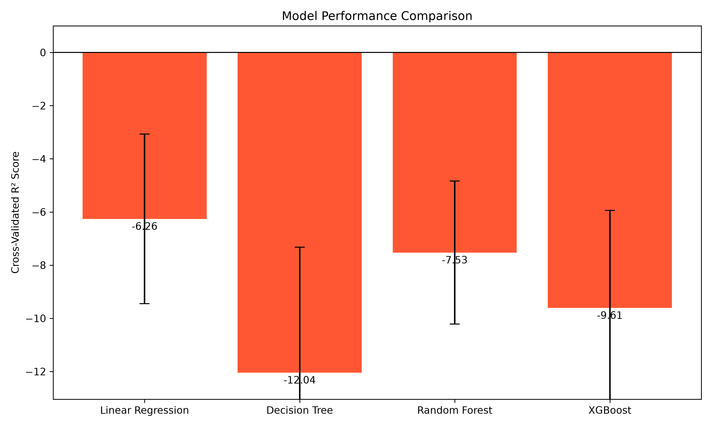
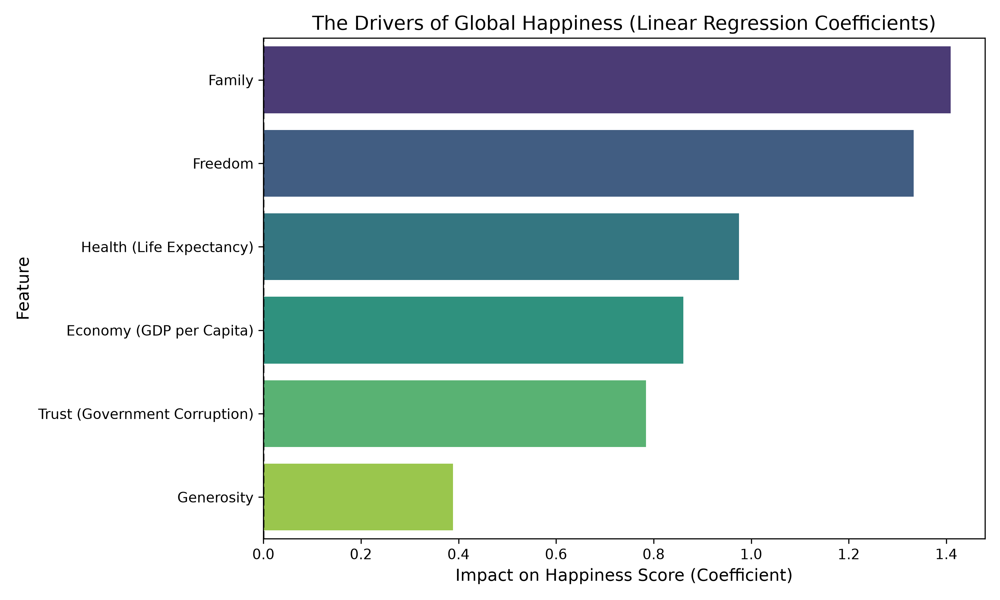

# Decoding the Smile: What Machine Learning Taught Us About Global Happiness

**By Behrooz Moniri**

We all want to be happy. But what actually makes a country happy? Is it the size of its economy? The health of its citizens? To answer this, I turned to data and machine learning.

## 🛠️ The Project
Using the 2015 World Happiness Report dataset (158 countries), I trained four Machine Learning models (Linear Regression, Decision Tree, Random Forest, and XGBoost) to predict Happiness Scores based on economic and social factors.

## 📊 Key Findings
*   **The Simplest Model Won:** Linear Regression achieved an impressive **86.4% accuracy (R² = 0.864)** on unseen data, beating complex models like XGBoost which overfit the data.
*   **The Drivers of Happiness:** By extracting the Linear Regression coefficients, we found that **Economy (GDP)** and **Health** are the strongest mathematical drivers of happiness. 
*   **Generosity doesn't move the needle:** Surprisingly, the "Generosity" feature had almost no mathematical impact on the final score.

## 📈 Visualizations

*Linear Regression outperformed the complex models on the test set.*

*What actually drives happiness?*

## 💻 How to Run the Code
1. Clone this repository.
2. Install the required libraries: `pip install pandas numpy scikit-learn xgboost matplotlib seaborn openpyxl`
3. Run the script: `python HealthNWealth.py`